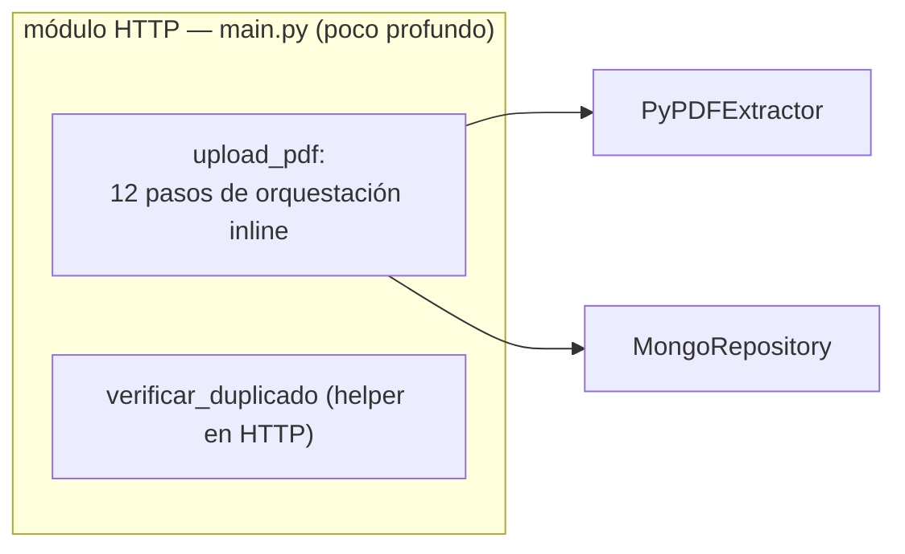
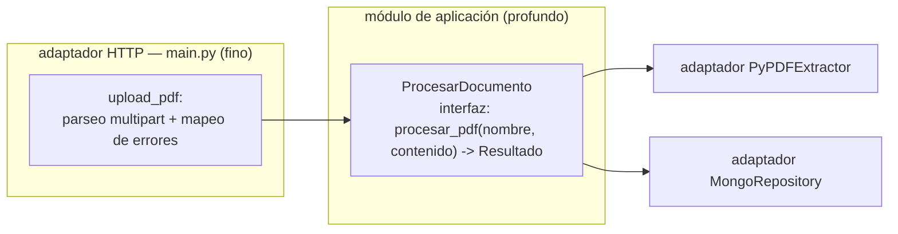
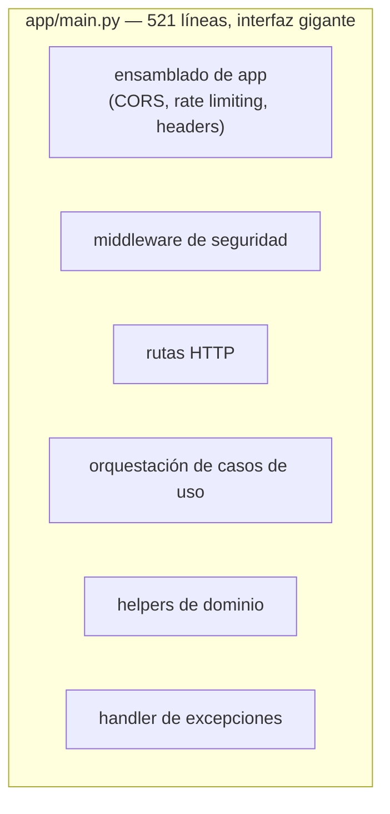
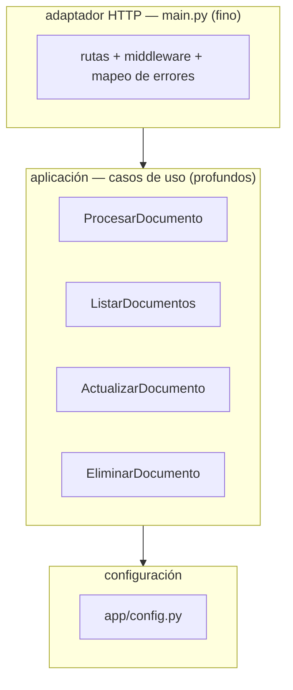

# Análisis de Arquitectura de Capas — PDF Extractor UTN

**Fecha:** 2026-08-18
**Alcance:** `app/`, `tests/`, `pyproject.toml`, `README.md`
**Pregunta:** ¿Qué arquitectura de capas se está utilizando (N capas, Hexagonal, Onion, Clean) y dónde está la fricción?

---

## 1. Resumen ejecutivo

El proyecto **reclama en el README una "arquitectura en capas" (3 capas: presentación, negocio, datos)** pero en la práctica es una arquitectura **N-capas incompleta**: la capa de negocio está casi vacía y la orquestación de negocio vive dentro del módulo HTTP.

Evaluado contra los cuatro estilos:

| Estilo | Grado de adopción | Verdicto |
|---|---|---|
| **N capas** | Parcial | De nombre, pero con capas rotas: presentación → datos directo |
| **Hexagonal** | Mínimo | Hay adaptadores informales, no hay puertos ni dominio central |
| **Onion** | Mínimo | No hay núcleo de dominio ni capa de aplicación; se viola la regla de dependencia |
| **Clean** | Mínimo | No hay casos de uso ni entidades; el caso de uso vive inline en el handler HTTP |

La fricción dominante está en **`app/main.py` (521 líneas)**: es un **módulo poco profundo** que mezcla ensamblado de la app, middleware de seguridad, rutas HTTP, orquestación de negocio y mapeo de errores. El caso de uso crítico (procesar un PDF) es una secuencia inline de 12 pasos dentro del endpoint `upload_pdf` que **no se puede testear a través de una interfaz limpia**; los tests hoy cruzan el seam patcheando el singleton `app.main.db`.

**Top recomendación:** extraer el caso de uso **`ProcesarDocumento`** como un módulo profundo con interfaz pequeña (`procesar_pdf(nombre, contenido) -> Resultado`), de modo que el módulo HTTP quede como un adaptador fino y los tests crucen el mismo seam que las rutas.

---

## 2. Vocabulario de diseño utilizado

Este reporte usa la terminología de *codebase-design* (evitando "componente", "servicio", "API"):

| Término | Significado |
|---|---|
| **Módulo** | Cualquier cosa con interfaz + implementación (función, clase, paquete, capa). |
| **Interfaz** | Todo lo que un llamador debe saber para usar el módulo: firma, invariantes, modos de error, configuración. |
| **Profundidad** | Apalancamiento en la interfaz: mucho comportamiento detrás de una interfaz pequeña. Un módulo es **profundo** cuando es así; **poco profundo** cuando su interfaz es casi tan grande como su implementación. |
| **Seam** | Lugar donde se puede alterar comportamiento sin editar en ese lugar; donde vive la interfaz de un módulo. |
| **Adaptador** | Una cosa concreta que satisface una interfaz en un seam. |
| **Apalancamiento (leverage)** | Lo que ganan los llamadores de un módulo profundo: más capacidad por unidad de interfaz aprendida. |
| **Localidad** | Lo que ganan los mantenedores: cambio, bugs, conocimiento y verificación se concentran en un lugar. |
| **Test de borrado** | Si borras el módulo y la complejidad desaparece, era un pass-through; si reaparece en N llamadores, merecía su lugar. |
| **"La interfaz es la superficie de prueba"** | Llamadores y tests deben cruzar el mismo seam. |
| **"Un adaptador = seam hipotético; dos = seam real"** | No introduzcas un seam salvo que algo varíe de verdad a través de él. |

**Nota:** no existe `CONTEXT.md` (glosario de dominio) ni ADRs en `docs/adr/`. El vocabulario del dominio — *Documento* con `archivo`, `texto`, `hash_seguridad` — existe solo como nombres de campo dentro de los dicts crudos de MongoDB, no como un modelo explícito. Esto ya es un hallazgo: el dominio es **implícito**, y por eso cada módulo re-inventa la convención (`_id`, nombre de campos, string mágico `"Vacio"` en `main.py:377`).

---

## 3. Estado actual: inventario de módulos

```
app/
├── main.py                  # 521 líneas — app FastAPI + middleware + rutas + orquestación + helpers
├── database.py              # MongoRepository — adaptador de persistencia (pymongo, síncrono)
├── dtos.py                  # 5 modelos Pydantic (2 sin uso)
├── exceptions.py            # DomainException + 4 errores de dominio
├── core/
│   ├── security.py          # saco de funciones de seguridad (~4 sin uso)
│   └── logging_config.py    # logging JSON rotativo
└── services/
    └── pdf_extractor.py     # PyPDFExtractor — adaptador pypdf/hashlib
```

Dependencias observadas (quién importa a quién):

- `main.py` → `database.py` (CRUD directo en las rutas), `services/pdf_extractor.py`, `core/security.py`, `core/logging_config.py`, `dtos.py`, `exceptions.py`.
- `tests/test_crud.py` → `app.main` (patchea `app.main.db`).
- `tests/test_extractor_completo.py` → `PyPDFExtractor` directo.
- `tests/test_exceptions.py` → `exceptions.py` directo.

---

## 4. Análisis por estilo arquitectónico

### 4.1 N capas (arquitectura en capas)

**Reclamo (README:27):** "Arquitectura en Capas: separación clara entre presentación, negocio y datos."

**Realidad:** tres capas nominales, pero la regla fundamental — *cada capa solo habla con su capa adyacente* — se rompe en varios puntos:

1. **Presentación → datos directo.** Los endpoints llaman al adaptador de persistencia saltándose la capa de negocio:
   - `db.guardar_documento(...)` → `main.py:379`
   - `db.obtener_por_checksum(...)` → `main.py:409, 446, 475, 511`
   - `db.listar_todos()` → `main.py:426`
   - `db.actualizar_nombre(...)` → `main.py:485`
   - `db.eliminar_documento(...)` → `main.py:515`

2. **La capa de negocio está casi vacía.** `services/pdf_extractor.py` (28 líneas) solo sabe extraer texto y calcular checksum. Toda la *orquestación* de negocio (validar tamaño, sanitizar nombre, validar magic numbers/MIME, deduplicar, sanitizar texto, persistir) vive **inline dentro de `upload_pdf`** (`main.py:331–390`) o en helpers colgados del módulo HTTP (`verificar_duplicado`, `main.py:407`).

3. **Lógica de negocio huérfana en la capa de presentación.** `validar_formato` (`main.py:393`) y `validar_tamaño` (`main.py:400`) están definidas en el módulo HTTP y **nunca se llaman**; el endpoint re-implementa la validación de tamaño duplicada (`main.py:339–342` y `main.py:358–361`).

4. **La capa de presentación conoce la superficie interna del adaptador de datos.** El health check hace `db.client.admin.command("ping")` (`main.py:293`): la capa HTTP sabe que el adaptador expone un `.client` de Mongo.

**Verdicto:** es una "2,5 capas". La capa de negocio debería concentrar el uso del dominio, pero casi no existe; lo que debería estar ahí sube a la presentación.

### 4.2 Hexagonal (puertos y adaptadores)

**Adaptadores informales presentes:**
- `MongoRepository` → adaptador de persistencia.
- `PyPDFExtractor` → adaptador de extracción de PDF.
- `main.py` → adaptador HTTP (FastAPI).

**Lo que falta:**
- **Puertos.** Ningún `Protocol`/ABC declara "necesito un repositorio de documentos con estas operaciones" ni "necesito un extractor de texto". El dominio no está en el centro: las entidades son dicts crudos de Mongo y el vocabulario del dominio es implícito en nombres de campo.
- **Un solo adaptador = seam hipotético.** Solo hay un `MongoRepository` y un `PyPDFExtractor`; formalizar puertos hoy sería especulativo según el principio *"un adaptador = seam hipotético; dos = seam real"*. La fricción real no es la falta de `Protocol` — es la **ausencia de capa de aplicación** y el hecho de que `main.py` salta por encima de todo hasta el adaptador de datos.
- **Los tests no cruzan un seam del dominio.** `test_crud.py` parchea `app.main.db` (el singleton dentro del módulo HTTP), no un puerto del caso de uso. El seam que de verdad importa (el de "procesar un documento") no existe para los tests: hay que atravesar HTTP + parchear un atributo de módulo.

**Verdicto:** esqueleto hexagonal por casualidad, no por diseño.

### 4.3 Onion (cebolla)

- **No hay núcleo de dominio** (entidades/servicios de dominio) en el centro.
- **No hay capa de aplicación** que orqueste casos de uso alrededor de ese núcleo.
- **La regla de dependencia se viola:** la capa más externa (HTTP) llama directo a la infraestructura más interna (MongoClient) a través de `db` (`main.py:379, 409, ...`).
- Lo más cercano al dominio (`exceptions.py`, `dtos.py`) no da forma al dominio: los DTOs `DocumentoResponse` y `ListaDocumentosResponse` existen y **no se usan** (la lista devuelve dicts crudos, `main.py:426–428`).

**Verdicto:** el cebolla no está plantado; no hay anillos, hay una sola pila con la presentación encima de todo.

### 4.4 Clean (limpia)

- **No hay casos de uso (use-cases).** El flujo "procesar un PDF" es un caso de uso *implícito* ejecutado inline en el handler (`upload_pdf`, `main.py:331–390`).
- **No hay entidades.** Los objetos del dominio son dicts de Mongo sin tipo.
- **No hay inversión de dependencias formal.** La aplicación no declara qué necesita; simplemente usa singletons creados en el módulo HTTP (`extractor = PyPDFExtractor()`, `db = MongoRepository()`, `main.py:230–231`), con efectos secundarios en import time (conexión/config).

**Verdicto:** el README aplica "principios de Clean Code" (nombres intencionales, funciones pequeñas) pero eso no es arquitectura Clean.

---

## 5. Fricciones y oportunidades de profundización

Cada candidato muestra el problema, la solución, los beneficios y un antes/después. El objetivo es pasar de módulos **poco profundos** a módulos **profundos**: mucho comportamiento detrás de una interfaz pequeña.

### C1 — Extraer el caso de uso `ProcesarDocumento`

**Archivos:** `app/main.py:331–390`, `app/main.py:407`, `app/services/pdf_extractor.py`, `app/database.py`

**Problema.** El flujo de upload (validar tamaño, sanitizar nombre, leer contenido, validar magic numbers/MIME, calcular checksum, deduplicar, extraer texto, sanitizar, persistir) es una secuencia inline de 12 pasos en el endpoint. Es **comportamiento profundo con una interfaz invisible**: nadie puede ejercerlo sin montar HTTP y parchear el singleton `db`. Los bugs reales de este flujo (orden de validaciones, un paso omitido) no tienen superficie de prueba. El **test de borrado** responde claro: borrar la orquestación no elimina complejidad, la redistribuye — la secuencia merece un módulo propio.

**Solución.** Crear un módulo de aplicación `app/usecases/procesar_documento.py` con una interfaz pequeña y profunda:

```python
def procesar_pdf(nombre: str, contenido: bytes) -> ResultadoDocumento: ...
```

El módulo declara sus dependencias (un extractor, un repositorio) como parámetros — *acepta dependencias, no las crea* — y concentra la orquestación. El endpoint se reduce a parsear el multipart, llamar al caso de uso y mapear errores de dominio a HTTP.

**Beneficios.**
- **Localidad:** el flujo completo de "procesar documento" se concentra en un lugar; un cambio de reglas (p. ej. nuevo límite de tamaño) se toca una vez, no en el handler.
- **Apalancamiento:** una implementación paga por la ruta `/upload` *y* por los tests del caso de uso.
- **Tests:** "la interfaz es la superficie de prueba": los tests cruzan `procesar_pdf(...)` con adaptadores fake, sin HTTP ni parcheo de singletons. Se testea el orden de la orquestación, no el efecto secundario.

**Antes:**



**Después:**



**Recomendación:** `Strong` — es la fricción más alta y desbloquea a C2 y C3.

---

### C2 — Adelgazar el mega-módulo `main.py`

**Archivos:** `app/main.py` (521 líneas)

**Problema.** Un solo módulo es a la vez: ensamblado de la app (`main.py:57–172`), middleware de seguridad (`main.py:178–224`), adaptador HTTP (rutas, `main.py:255–521`), capa de aplicación (orquestación de `upload_pdf`), helpers de dominio (`main.py:393–411`) y mapeo de excepciones (`main.py:237–249`). Su **interfaz** (todo lo que hay que saber para tocarlo) es tan grande como su **implementación**: es un **módulo poco profundo** por definición. El test de borrado: no existe un "resto" si lo borras; cada preocupación se vuelve a crear entera en cualquier otro lado.

**Solución.** Separar por seams:
- **`main.py`** → adaptador HTTP: rutas, middleware, mapeo de errores de dominio a HTTP. Depende del framework.
- **`app/usecases/`** → casos de uso (aplicación): `ProcesarDocumento`, `ListarDocumentos`, `ActualizarDocumento`, `EliminarDocumento`. Sin conocimiento de FastAPI.
- **`app/config.py`** → lectura de entorno (límites, orígenes, claves). Hoy eso es un amasijo de `os.getenv` con defaults dispersos (`main.py:60–102`).

**Beneficios.**
- **Localidad:** cada preocupación se modifica en su módulo; el conocimiento sobre HTTP no contamina los casos de uso.
- **Apalancamiento:** los casos de uso se reutilizan por rutas y por tests; el adaptador HTTP queda repetitivo y trivial.
- **Tests:** los casos de uso se prueban sin levantar la app; el adaptador HTTP se prueba solo para el mapeo de errores y el parseo.

**Antes:**



**Después:**



**Recomendación:** `Strong` — es el punto caliente del proyecto (hot spot en `git log`), y el refactor de mayor impacto para la navegabilidad por parte de agentes y humanos.

---

### C3 — Dar forma de dominio a la salida del adaptador `MongoRepository`

**Archivos:** `app/database.py`, `app/dtos.py`, `app/main.py:424–452`

**Problema.** La interfaz del adaptador de persistencia **filtra detalles de Mongo**: devuelve dicts crudos con campos `archivo`, `texto`, `hash_seguridad`, y los llamadores deben saber quitar `_id` a mano (`main.py:451`). El conocimiento que el llamador necesita (nombres de campos, limpieza de `_id`) es casi tan grande como la implementación del adaptador → **poco profundo**. Además, los DTOs que le darían forma al dominio (`DocumentoResponse`, `ListaDocumentosResponse`, `dtos.py:5,12`) existen y están **muertos**: el endpoint lista dicts crudos (`main.py:426–428`).

**Solución.** Que el adaptador devuelva un objeto de dominio tipado (el `Documento` que ya se intuye en los DTOs), con la limpieza de `_id` y el mapeo de campos concentrados **en el seam**, no en cada llamador. (No hace falta introducir un `Protocol` todavía — un adaptador solo, seam hipotético — pero sí tiene sentido que la salida tenga forma de dominio.)

**Beneficios.**
- **Localidad:** el conocimiento de Mongo (nombres de campo, `_id`) queda dentro del adaptador; desaparece el `pop("_id")` repetido en la capa HTTP.
- **Apalancamiento:** el tipo `Documento` se reutiliza en DTOs, casos de uso y tests; los tests verifican un objeto con campos tipados, no un dict libre.
- **Tests:** el contrato del adaptador se testea una vez (mapeo correcto), no en cada endpoint.

**Antes:**


**Después:**


**Recomendación:** `Worth exploring` — no es urgente (un adaptador = seam hipotético), pero la fricción del dict crudo es real y los DTOs muertos son una señal de que el dominio quiere salir.

---

### C4 — Eliminar código muerto

**Archivos:** `app/main.py:393,400` · `app/database.py:41` · `app/dtos.py:5,12` · `app/core/security.py:42–56,176–178`

**Problema.** La **interfaz** de varios módulos incluye funciones que nadie usa; un mantenedor o un agente debe leerlas para descubrir que están muertas:

| Función | Módulo | Estado |
|---|---|---|
| `validar_formato` | `main.py:393` | definida, nunca llamada |
| `validar_tamaño` | `main.py:400` | definida, nunca llamada (el endpoint duplica su lógica) |
| `existe_documento` | `database.py:41` | definida, nunca llamada |
| `DocumentoResponse`, `ListaDocumentosResponse` | `dtos.py:5,12` | definidas, nunca usadas |
| `hash_password`, `verify_password`, `generate_hmac` | `security.py:45,50,176` | definidas, nunca usadas |

**Solución.** Borrar. El **test de borrado** es contundente: la complejidad desaparece por completo, no se redistribuye. (Es limpieza, no profundización — pero aclara la interfaz de módulos que sí se van a profundizar en C1–C3.)

**Beneficios.**
- **Localidad:** la superficie viva de cada módulo se ve sin escarbar.
- **Apalancamiento:** menos interfaz que aprender para llamadores y tests.
- **Tests:** los tests de exceptions (`test_exceptions.py`) y de extractor (`test_extractor_completo.py`) sobreviven intactos; se puede correr `ruff` (ya está en dev-deps) para confirmar cero referencias.

**Recomendación:** `Strong` — trivial, sin riesgo, gana pura. Hacerlo antes de C1–C3 evita arrastrar ruido.

---

### C5 — Formalizar puertos (Protocols) para persistencia y extracción

**Archivos:** `app/database.py`, `app/services/pdf_extractor.py`, `app/usecases/*`

**Problema / contexto.** Hoy no hay `Protocol` que declare "repositorio de documentos" ni "extractor de texto". Pero según el principio **"un adaptador = seam hipotético; dos = seam real"**, introducir un `Protocol` ahora, con un único `MongoRepository` y un único `PyPDFExtractor`, **no compra nada**: el seam solo paga cuando algo varía de verdad a través de él (un segundo motor de BD, un segundo extractor, o tests que necesiten un fake *real*).

**Solución.** No formalizar puertos todavía. En cambio, dejar que los casos de uso de C1–C3 **acepten dependencias por parámetro** (interfaz implícita de Python: duck typing). Si en el futuro llega un segundo adaptador, el seam se materializa solo donde varía.

**Beneficios (si se hace bien, vía C1).** Tests con fakes sin mocks mágicos; cero infraestructura de interfaces que hoy sería decorativa.

**Recomendación:** `Speculative` — no hacerlo hoy; la disciplina de "aceptar dependencias, no crearlas" en C1 cubre la misma necesidad.

---

## 6. Top recomendación

**C1 — extraer el caso de uso `ProcesarDocumento` primero.**

Razones:

1. **Es donde está el riesgo real.** El flujo de upload es el corazón del producto y hoy no tiene superficie de prueba propia: los 12 pasos de orquestación solo se ejercitan vía HTTP + parcheo de `app.main.db`. Un bug de orden u omisión de validación se detecta tarde.
2. **Desbloquea a los demás.** Al sacar la orquestación de `main.py`, el módulo HTTP adelgaza naturalmente (C2 queda casi resuelto), y el caso de uso necesita que el repositorio devuelva objetos con forma de dominio (C3).
3. **Es el refactor más seguro.** No cambia contratos externos: las rutas siguen existiendo; solo cambia *dónde* vive la lógica y *por dónde* se testea.

**Orden de ejecución sugerido:** C4 (limpieza) → C1 (caso de uso) → C2 (adelgazar main) → C3 (forma de dominio) → C5 (revisitar solo si aparece un segundo adaptador).

---

## 7. Notas sobre tests e infraestructura

- **La suite hoy no corre.** `uv run pytest` falla al colectar `tests/test_crud.py` con `ModuleNotFoundError: No module named 'itsdangerous'` (dependencia transitiva de Starlette, ausente de `uv.lock`). Cualquier refactor debe dejar la suite verde — primero hay que arreglar esto.
- **Los 23 tests** se distribuyen en: extractor (5), CRUD (12) y excepciones (6). Los de CRUD son el punto ciego: parchean el singleton `app.main.db` y por tanto verifican *respuestas HTTP*, no la orquestación del caso de uso.
- **Sin glosario de dominio.** No hay `CONTEXT.md`. Al profundizar, conviene crear uno y nombrar `Documento` y `ProcesarDocumento` explícitamente para que el vocabulario de los seams sea estable.

---

*Elaborado con la metodología de revisión de arquitectura de `improve-codebase-architecture` y el vocabulario de `codebase-design` (módulo, interfaz, profundidad, seam, adaptador, localidad, leverage).*
